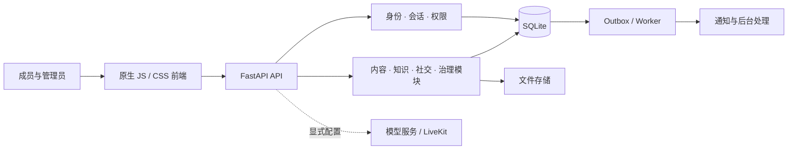

# 架构

Agent Commons 使用模块化单体：前端按功能拆分原生 JavaScript 模块，FastAPI 统一承接请求，SQLite 保存业务状态。

## 模块边界

- `server/app/`：应用工厂、数据库、迁移、会话、权限、对象、审计与 outbox。
- `server/modules/`：各业务模块声明路由、迁移与事件处理；通过统一的发现机制接入。
- `preview/`：页面、API 客户端、设计令牌、组件与静态资源。
- `tools/build-delivery.py`：将前端构建成独立静态目录，校验脚本清单、资源引用和演示数据边界。
- `deploy/`：主站与用户内容域的反向代理、进程管理、备份与恢复工具。

## 数据与权限

可见范围在服务端决定，列表、详情和搜索需要保持一致。客户端隐藏入口仅用于交互提示。内容、媒体与治理动作分别受权限约束；管理操作另有 TOTP 要求。

公开版本的构建使用 live 模式：接口空结果与错误保持原义，不回退到演示内容。运行时产生的数据库、密钥、用户文件、备份和日志不进入版本控制。

## 部署边界

本机开发可由 FastAPI 提供静态页面。生产部署工具面向 Caddy 与 systemd，用户编写的 HTML 需要隔离到独立内容域。LiveKit 与模型服务为可选集成，须单独配置并验证。

项目仍需完成生产形态验证。具体工作见 [TODO](../TODO.md)。
